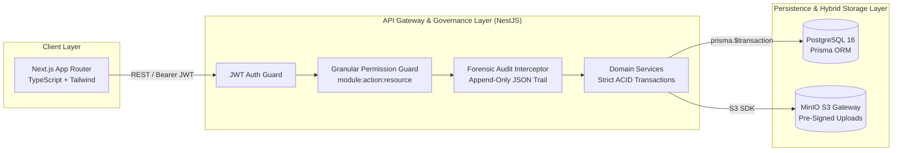

# Enterprise NestJS + Next.js Monorepo Starter
**Production-Ready B2B Architecture | Granular RBAC, Immutable Audit Interceptor, Prisma ORM & MinIO S3 Docker Stack**

A clean-room, production-grade foundation for building internal enterprise portals, financial back-office systems, and compliance-heavy B2B applications. Extracted from real-world architectural patterns used across multi-branch banking operations.

---

## 1. Architectural Philosophy

Most boilerplate repositories focus on basic CRUD and toy authentication. Enterprise internal systems fail not because of missing UI components, but due to **weak access control**, **untraceable data mutations**, and **fragile deployment pipelines**.

This starter enforces three non-negotiable enterprise invariants out of the box:
1. **Capability-Based Granular RBAC (`module:action:resource`):** Role names (`ADMIN`, `STAFF`) are decoupled from code logic. Route guards evaluate explicit permission strings (e.g., `treasury:approve:disbursement`).
2. **Zero-Effort Forensic Audit Logging:** A declarative NestJS `@Auditable()` interceptor automatically captures the actor ID, client IP, route metadata, and JSON payload mutations into an append-only audit table.
3. **Self-Hosted S3 Storage Parity:** Pre-configured with local **MinIO** object storage alongside **PostgreSQL 16** in Docker Compose, ensuring 100% parity between local development, on-premise NAS deployments, and AWS S3.



---

## 2. Monorepo Directory Structure

```text
.
├── README.md
├── docker-compose.yml
└── apps/
    ├── api/                                      # NestJS Backend Engine
    │   └── src/
    │       ├── common/
    │       │   ├── decorators/
    │       │   │   ├── permissions.decorator.ts  # @RequirePermissions('module:action:resource')
    │       │   │   └── auditable.decorator.ts    # @Auditable('MODULE_NAME', 'ACTION')
    │       │   ├── guards/
    │       │   │   └── permissions.guard.ts      # Zero-trust capability evaluator
    │       │   └── interceptors/
    │       │       └── audit-log.interceptor.ts  # Automatic forensic mutation logger
    │       └── prisma/
    │           └── prisma.service.ts             # Connection pooling & lifecycle management
    └── web/                                      # Next.js App Router Frontend
```

---

## 3. Usage Pattern: Declarative Security & Auditing

By combining custom decorators with NestJS Guards and Interceptors, domain controllers remain 100% clean of boilerplate security or logging code:

```typescript
@Controller('v1/procurement/purchase-orders')
@UseGuards(JwtAuthGuard, PermissionsGuard)
@UseInterceptors(AuditLogInterceptor)
export class PurchaseOrderController {
  constructor(private readonly poService: PurchaseOrderService) {}

  @Post(':id/approve')
  @RequirePermissions('procurement:approve:po')
  @Auditable('PROCUREMENT', 'APPROVE_PURCHASE_ORDER')
  async approvePurchaseOrder(
    @Param('id', ParseUUIDPipe) poId: string,
    @CurrentUser() user: AuthenticatedUser,
  ) {
    return this.poService.executeSignerApproval(poId, user);
  }
}
```

---

## 4. Quick Start (Docker Production Stack)

Spin up the complete infrastructure stack (`PostgreSQL 16`, `MinIO S3`, `NestJS API`, and `Next.js Web`):

```bash
# 1. Start infrastructure services
docker compose up -d postgres minio

# 2. Run Prisma migrations
cd apps/api && npx prisma migrate deploy

# 3. Launch full stack
docker compose up --build -d
```

---

## 5. Author & Architecture Consulting
Architected and maintained by **Andriawan Maris** — Senior Full-Stack Engineer & Infrastructure Architect.
* **Email:** [mail@marisandriawan.my.id](mailto:mail@marisandriawan.my.id)
* **Availability:** Asynchronous Remote Contracts, Technical Backlog Execution & On-Premise/Hybrid Cloud Architecture.
